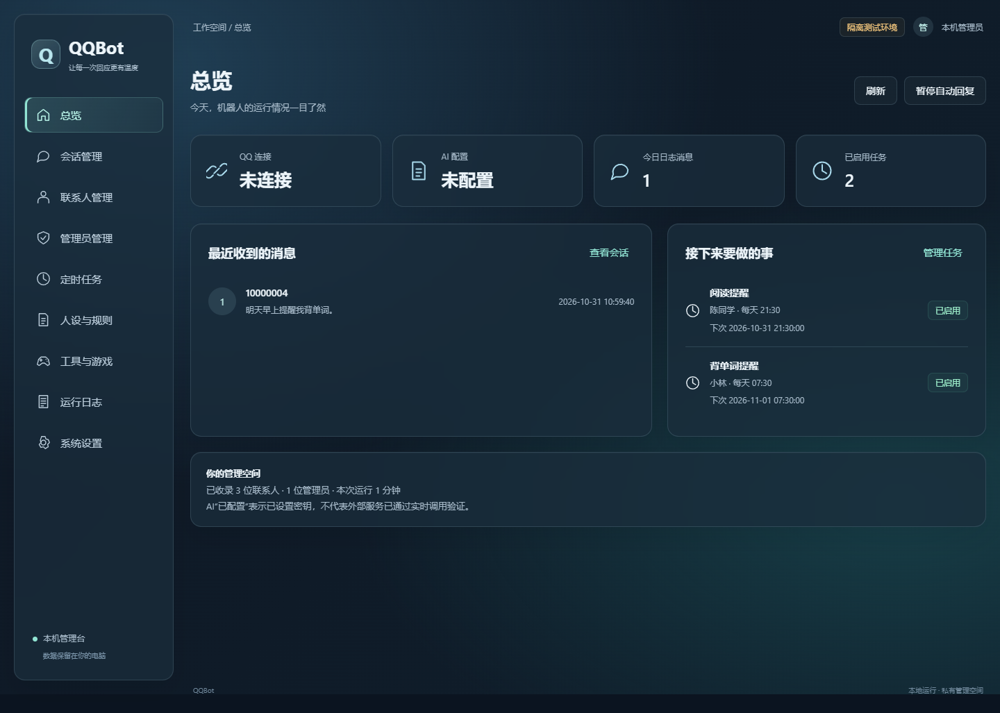
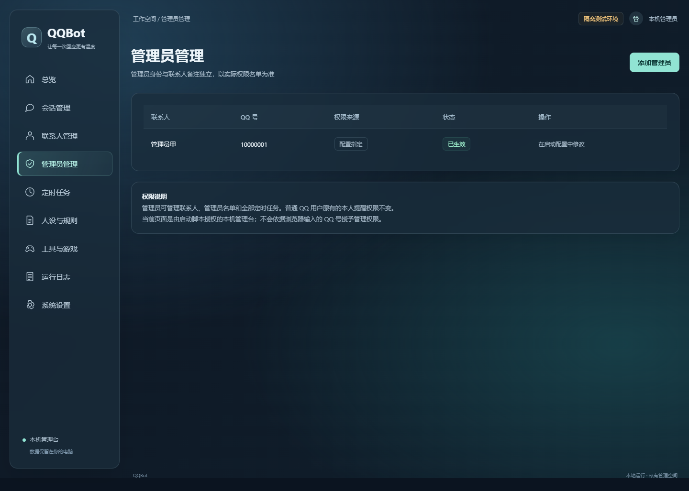
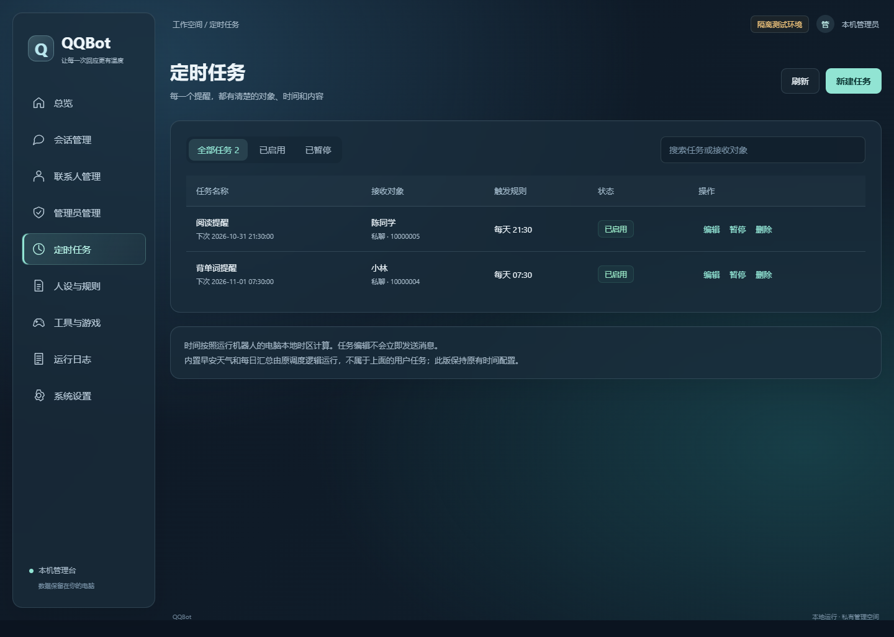
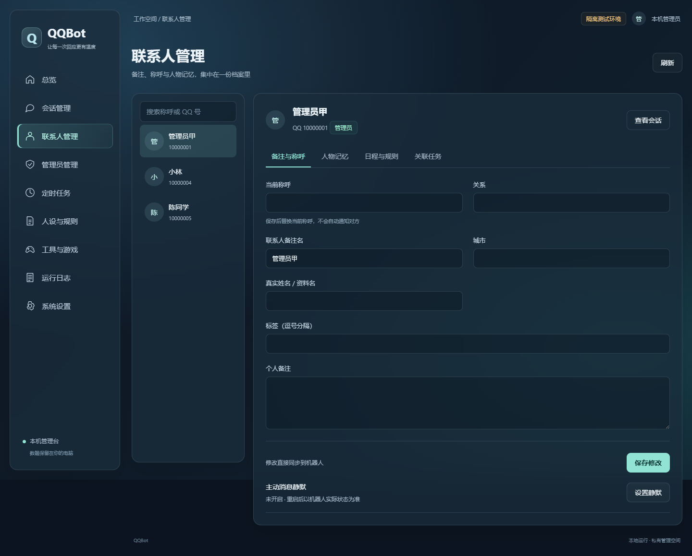
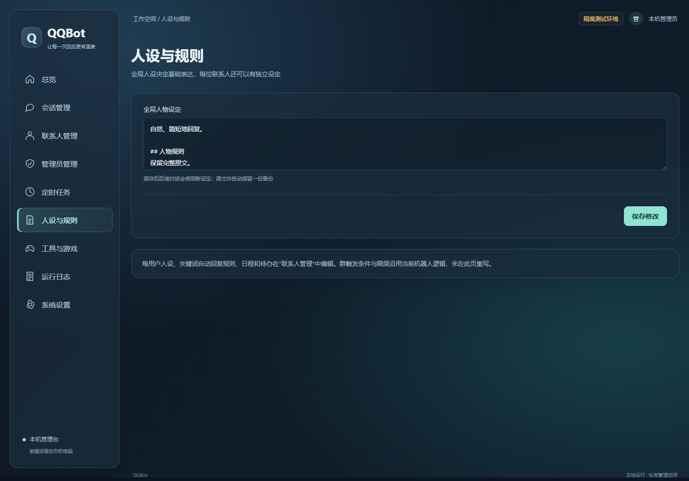

# QQBot 管理台

一个面向自助配置的 QQ 机器人与本机管理界面。默认不预设机器人称呼、人设、管理员、联系人或地区；克隆后请用自己的账号和配置。界面采用深色毛玻璃风格，管理联系人备注与称呼、管理员名单、定时任务、会话和人设。

> 当前版本面向 Windows 本机运行。QQ、NapCat、Python 和 AI 服务账号由使用者自行安装及配置。深度任务和文件相关工具暂时关闭；本机 OneBot 连接尚未支持 Token，不要部署到公网或多人共享服务器。

## 界面截图

截图使用隔离测试环境和虚构数据，不含真实 QQ 账号、会话或密钥。

| 总览 | 管理员 | 定时任务 |
| --- | --- | --- |
|  |  |  |

| 联系人备注与称呼 | 人设设置 |
| --- | --- |
|  |  |

## 快速开始

1. 安装 Windows 10/11 64 位、Python 3.11 或更高版本（包含 `py` 启动器）、Git、QQ 和 NapCat。
2. 克隆仓库，或从 GitHub 下载 ZIP 并解压到一个有读写权限的目录。Git 克隆示例：

   ```powershell
   git clone https://github.com/suliu496-glitch/qqbot-management-ui.git
   cd qqbot-management-ui
   ```
3. 双击 `install.bat` 创建虚拟环境并安装依赖；首次安装会从 `.env.example` 生成 `.env`。
4. 在本机编辑 `.env`，填写 `MY_QQ`、`MASTER_QQ`、`SELF_NICK` 和 `DEEPSEEK_API_KEY`。不要将 `.env` 发给别人或提交到 GitHub。
5. 编辑 `persona.txt` 设置机器人的人设；`roles.json` 初始为空。按下方说明配置 NapCat。
6. 登录自己的 QQ/NapCat 后，双击 `start-qq-bot.bat`。保持命令窗口运行，管理界面会自动打开。
7. 先用自己的测试账号或测试群验证收发、管理员、称呼备注和定时任务。机器人实际收发未做在线验证。

## 功能使用

- **管理员**：在“管理员管理”查看或添加管理员。管理员身份来自机器人配置与管理操作，联系人备注不会授予权限。只添加可信账号。
- **联系人资料**：在“联系人管理”编辑联系人备注名、当前称呼、关系、城市、标签、个人备注、人物记忆和单独人设。更改后会影响机器人之后的对话。
- **定时任务**：在“定时任务”新建、编辑、暂停、恢复或删除提醒；选择私聊或群聊目标、频率和发送内容。已启用任务会按配置主动发送消息，创建前确认接收对象和发送内容。
- **会话**：查看本地记录、暂停自动回复；人工发送会以机器人身份真实联系对方，页面会要求确认。
- **全局人设与规则**：设置全局表达方式；单个联系人的特别规则在其联系人档案中管理。
- **启动与停止**：`start-qq-bot.bat` 启动机器人和管理页；`stop-qq-bot.bat` 只停止本项目机器人进程，不会关闭 QQ/NapCat。

## NapCat 本机连接

在 NapCat 的 OneBot v11 配置中启用 HTTP 服务端与正向 WebSocket 服务端，默认只绑定 `127.0.0.1`，端口分别是 `3000` 和 `3001`。`.env` 中 `NAP_CAT_HTTP` 与 `NAP_CAT_WS` 应与 NapCat 一致。不要映射公网端口，也不要将 NapCat 管理凭据、登录二维码或管理台带令牌的地址分享给他人。

## 安全与隐私

- 仓库不包含 API Key、QQ 登录态、聊天数据库、联系人数据、备份或本机日志。
- 密钥放在本机 `.env`；管理界面不会把 AI 密钥返回给浏览器。`.env`、`data/`、SQLite 文件和日志均已加入 `.gitignore`。
- 默认 `QQBOT_AUTO_DIGEST=0`；需主动开启自动汇总时再修改配置。用户自行创建的已启用定时任务仍会主动发送消息。
- 管理界面只监听 `127.0.0.1`，并依赖本次启动生成的临时凭据。请在机器人所在电脑本机使用。
- 本项目未宣称通过完整安全审计。OneBot Token 支持尚未实现，NapCat 连接仅适合可信本机环境；不能直接对公网开放或作为多人共享服务器部署。
- 深度任务与文件操作工具在本发行版中关闭；跨用户聊天检索限制为管理员。

## 配置与故障排查

- 必填项：`MY_QQ`（机器人账号）、`MASTER_QQ`（管理员 QQ，可用英文逗号分隔）、`SELF_NICK`（使用者自行决定的机器人称呼）、`DEEPSEEK_API_KEY`。
- 可选项：`ZHIPU_API_KEY`、`DEFAULT_CITY`、模型服务 URL、NapCat 地址和端口，详见 `.env.example`。
- 缺少配置：检查本地 `.env` 是否保存完整；不要把密钥贴到问题反馈。
- QQ 未连接：确认 QQ/NapCat 已登录，HTTP 和正向 WS 监听在回环地址，端口与 `.env` 一致。
- AI 无回复：确认 API Key、服务余额、模型和网络；外部 API 调用可能产生费用。
- 管理界面打不开：从启动脚本自动打开的页面进入；重启后旧登录凭据失效。不要转发含 `#token=` 的链接。

完整中文说明见 [`AI部署说明.md`](AI部署说明.md)。测试说明见 `tests/`；自动化测试只使用临时目录和虚构数据。

## 许可证

本项目采用 MIT License，见 [`LICENSE`](LICENSE)。

---

## English

A configurable QQ bot with a local frosted-glass management console. The starter configuration has no preset bot nickname, persona, administrators, contacts, or city. Configure your own accounts and preferences after cloning.

> This release targets local use on Windows. QQ, NapCat, Python, and AI service credentials must be supplied by each user. Deep-task and file-related tools are disabled. The current OneBot client does not support an access token; do not expose it to the public Internet or use it on a shared server.

### Screenshots

Screenshots use synthetic test data only. They contain no real QQ accounts, conversations, or API keys.

| Overview | Administrator management | Scheduled tasks |
| --- | --- | --- |
|  |  |  |

| Contact notes and nicknames | Persona settings |
| --- | --- |
|  |  |

### Quick start

1. Install 64-bit Windows 10/11, Python 3.11 or later with the `py` launcher, Git, QQ, and NapCat.
2. Clone this repository, or download its ZIP archive and extract it to a writable folder:

   ```powershell
   git clone https://github.com/suliu496-glitch/qqbot-management-ui.git
   cd qqbot-management-ui
   ```

3. Run `install.bat`. It creates a virtual environment, installs Python dependencies, and creates `.env` from `.env.example` if `.env` does not already exist.
4. Edit `.env` locally and set `MY_QQ`, `MASTER_QQ`, `SELF_NICK`, and `DEEPSEEK_API_KEY`. Never commit or share `.env`.
5. Edit `persona.txt` to choose the bot's personality. `roles.json` starts empty. Configure NapCat as described below.
6. Log in to your own QQ/NapCat account, then run `start-qq-bot.bat`. Keep the console window open; the management UI opens automatically.
7. First, verify messaging, administrator access, contact notes/nicknames, and scheduled tasks using only your own test account or group. Live QQ delivery has not been verified by this release.

### Features

- **Administrators:** View and add QQ accounts that can manage the bot. Contact notes do not grant permissions. Add only trusted accounts.
- **Contact profiles:** Edit display notes, preferred nicknames, relationships, city, tags, personal notes, memories, and per-contact personas.
- **Scheduled tasks:** Create, edit, pause, resume, and delete reminders. Choose a private or group destination, frequency, and message. Enabled tasks send messages on schedule; verify the destination and content before enabling them.
- **Conversations:** View local records and pause automatic replies. Manual messages are sent as the bot and require confirmation in the UI.
- **Persona and rules:** Set the global persona; per-contact settings live in each contact profile.
- **Start and stop:** `start-qq-bot.bat` starts the bot and UI. `stop-qq-bot.bat` stops only this project's bot process; it does not stop QQ or NapCat.

### Local NapCat connection

In NapCat's OneBot v11 settings, enable an HTTP server and a forward WebSocket server, bound to `127.0.0.1` only. The default ports are `3000` and `3001`; `NAP_CAT_HTTP` and `NAP_CAT_WS` in `.env` must match. Do not expose these ports publicly or share NapCat credentials, login QR codes, or the management URL containing a `#token=` fragment.

### Security and privacy

- The repository contains no API keys, QQ login state, conversation database, contact data, backups, or local logs.
- Keep credentials in the local `.env` file. The management UI does not return AI key values to the browser. `.env`, `data/`, SQLite databases, and logs are ignored by Git.
- Automatic morning and daily digest messages are off by default (`QQBOT_AUTO_DIGEST=0`). User-created enabled tasks can still send messages.
- The management UI listens on `127.0.0.1` and uses a temporary credential generated for each run. Use it only on the computer running the bot.
- This release has not undergone a comprehensive security audit. OneBot token support is not implemented; the NapCat connection is suitable only for a trusted local environment. Do not expose the bot or UI publicly or use them as a shared server service.
- Deep-task and file-operation tools are disabled. Cross-user conversation search is limited to administrators.

### Configuration and troubleshooting

- Required `.env` values: `MY_QQ` (bot account), `MASTER_QQ` (administrator QQ IDs, comma-separated), `SELF_NICK` (your chosen bot nickname), and `DEEPSEEK_API_KEY`.
- Optional values include `ZHIPU_API_KEY`, `DEFAULT_CITY`, model service URLs, and NapCat endpoints. See `.env.example`.
- **Missing configuration:** Check your local `.env`; never paste keys into support requests.
- **QQ not connected:** Confirm QQ/NapCat is logged in, both OneBot endpoints bind to loopback, and the ports match `.env`.
- **No AI reply:** Check the API key, account balance, model, and network. External API calls may incur charges.
- **UI unavailable:** Open the page launched by the startup script. Restarting invalidates the previous temporary login credential. Never forward a URL containing `#token=`.

Read [`AI部署说明.md`](AI部署说明.md) for the Chinese AI-assisted deployment guide, or [`docs/AI_DEPLOYMENT_EN.md`](docs/AI_DEPLOYMENT_EN.md) for English. Automated UI tests use temporary folders and synthetic data only.

### License

This project is released under the MIT License. See [`LICENSE`](LICENSE).
